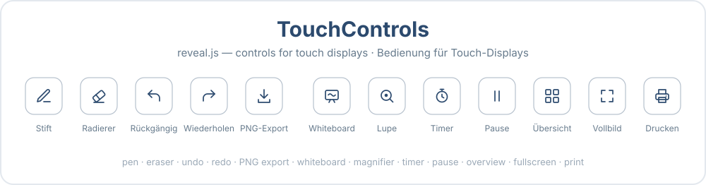

# Reveal - TouchControls

[](https://revealjs.com) [](LICENSE)

On-screen controls that make [reveal.js](https://revealjs.com) easy to operate on touch displays and smartboards: annotate with a pen, erase and undo strokes, export drawings as PNG, open a separate whiteboard, focus on a detail, run a countdown timer, blank the screen, open the overview, go fullscreen, print the slides. No keyboard or mouse needed. Standalone (ships its own CSS) and a natural companion to [Smallcontrol](https://github.com/Martinomagnifico/reveal.js-smallcontrol).

**[Live demo](https://florianloyns.github.io/reveal.js-touchcontrols/demo.html)**

[](https://florianloyns.github.io/reveal.js-touchcontrols/demo.html)

## Installation

**Requires** reveal.js 4.2 or newer. Tested with reveal.js 5.x.

Copy the `touchcontrols` folder into your reveal.js `plugin/` folder — or install from npm.

```console
npm install reveal.js-touchcontrols
```

## Setup

**Regular**

```html
<script src="dist/reveal.js"></script>
<script src="plugin/touchcontrols/touchcontrols.js"></script>
<script>
  Reveal.initialize({ plugins: [ RevealTouchControls ] });
</script>
```

**As a module**

```html
<script type="module">
  import Reveal from './dist/reveal.esm.js';
  import RevealTouchControls from './plugin/touchcontrols/touchcontrols.esm.js';
  Reveal.initialize({ plugins: [ RevealTouchControls ] });
</script>
```

## Usage

- **Pen** — repeatedly tap the same icon to cycle through **red → blue → fading ink → off** (or the colors listed in `inks`, followed by fading ink when enabled). **Hold the pen** (about half a second) to **clear the current slide** completely, or the whiteboard while it is open. Other slides keep their notes, the selected ink stays the same, and Undo brings the drawing back. The active pen has a solid outline in the selected ink color; fading ink uses a dotted outline. Marks belong to individual slides and remain when navigating between slides. Set `keepAnnotations: false` for clearing them on slide changes. Reloading starts with clean slides unless `persistAnnotations: true` is enabled.
- **Eraser** — touch or drag across a stroke to remove it. Each gesture can be undone. A stroke is erased as a whole, not pixel by pixel.
- **Undo / Redo** — reverse or redo pen strokes, erasing and clearing, independently for each slide and for the whiteboard. `Ctrl/Cmd+Z` and `Ctrl/Cmd+Shift+Z` work while a drawing tool or the whiteboard is active.
- **Save** — download the current slide's strokes as a **transparent PNG**, or a white-background PNG while the whiteboard is open. This is an annotation export, not a screenshot of the slide content.
- **Whiteboard** — one tap opens a **separate** white surface and switches the pen on. Closing it returns to the original slide markings unchanged. Whiteboard notes remain available when reopened, unless `keepWhiteboard: false` is set.
- **Magnifier** — tap the magnifier icon once to show a circular 2× enlargement immediately at the center of the screen. Drag anywhere on the slide to move the lens, pinch with two fingers or use the mouse wheel to adjust its diameter, and tap the magnifier icon again (or press Escape) to close it. Text, photographs, inline SVG, diagrams, canvas graphics and saved pen annotations appear magnified inside an opaque lens, so the original small content does not show through; the original slide never scales. Set `lupeMode: 'spot'` for the former spotlight, or `'both'` / `'zoom'` to retain the older multi-step focus behaviours. The lens stays fully on-screen near the viewport edges while continuing to magnify the exact selected point. Its subtle, dual-contrast outline adapts to light and dark slides. Reveal fragments, DOM edits, and CSS animation/transition changes refresh automatically; live canvas content is synchronized while the lens is open. Embedded iframes and playing video are not mirrored.
- **Timer** — tap the icon to cycle **5 → 10 → 15 minutes → off** (or the `timerMinutes` presets you configured). No additional timer controls appear. **Hold the icon**, right-click or Shift-click to enter a custom number of minutes. **Tap the countdown itself** to pause/resume. The display stays visible across slides, uses wall-clock time and pulses red at 0:00.
- **Pause · Overview · Fullscreen** — one tap each.
- **Move toolbar** — flick the toolbar sideways to send it to the other bottom corner, or tap ⇄ in **More**. A short or slow drag snaps back, taps on the buttons work as usual and the slide does not change. On the right, the toolbar is mirrored, including the More menu (Pen and Eraser at the outer corner, Print innermost; Undo/Redo keep their order) and sits beside reveal.js' navigation arrows instead of covering them. The chosen side is remembered in this browser. Set `switchSide: false` to keep the bar fixed.
- **Print** — shown directly in the main toolbar on the **first and last slide**, with different actions. On the first slide it prints **all slides without annotations** (the original behaviour). On the last slide it prints **all slides with their permanent pen annotations**, attached to the corresponding slide. It opens the print view (`?print-pdf`) in a new tab and starts the print/PDF dialog. The print button is hidden on intermediate slides. **The same printer icon is used in both places — no pen overlay or extra icon.** With a single-slide deck the annotated version takes precedence. Speaker notes and temporary fading ink are not included. Works best in Chrome or Edge.

On dark slides the toolbar groups and buttons have transparent backgrounds, with subtle 1 px outlines and a solid active-state border. Buttons turn white automatically on dark slides. Browser/keyboard focus does not add a separate ring around icons (the selected tool is marked by its solid outline, fading ink by a dotted one), and the toolbar fades out when idle (returns on movement — the timer countdown always stays visible).

Drawing is palm-friendly: only the first touch draws, extra fingers are ignored, and vector strokes render crisply on high-DPI displays. The toolbar prioritizes the essential controls on narrow screens, automatically moving lower-priority controls (starting with Pause) into **More**. **More keeps the same position between slides** even when Print is hidden, and the printer is always last on the first and last slides. Touch targets are 42–44 px; hidden controls are removed from keyboard focus.

## Configuration

All options are optional.

```js
Reveal.initialize({
  touchcontrols: {
    side: 'left',                 // 'left' | 'right'
    switchSide: true,             // flick the bar (or use More) to move it to the other corner
    bottom: 32,                   // offset from the bottom, px
    accent: '#2C4A6E',            // button colour
    hover: 'rgba(44,74,110,.10)', // button hover colour
    inks: ['#D14A4A', '#2B6CB0'], // cycle red, blue, fading, off on pen taps
    penWidth: 4,                  // stroke width
    // Omit buttons for the new contextual default; explicit buttons[] preserves flat layout.
    toolbarMode: 'contextual',    // 'contextual' | 'flat'
    // buttons: ['pen','eraser','undo','redo','save','whiteboard','zoom','timer','pause','overview','fullscreen','side','print'],
    timerMinutes: [5, 10, 15],    // cycle these presets with each Timer tap
    autohide: true,
    autohideDelay: 3500,          // ms before hiding
    wakeZone: [340, 150],         // only pointer activity in this corner (px) wakes the bar; false = anywhere
    wakeOnKey: false,             // true = every key press (presenter, arrow keys) wakes it too
    lupeMode: 'magnifier',        // 'magnifier' (default) | 'spot' | 'both' | 'zoom'
    spotRadius: 120,              // lens/spotlight radius, CSS pixels
    spotDim: 0.55,                // how much the surroundings dim, 0–1
    zoomScale: 2,                 // magnification inside the lens (legacy: zoom step)
    keepAnnotations: true,        // marks stay on their slide instead of being wiped
    keepWhiteboard: true,         // whiteboard notes survive closing/reopening
    persistAnnotations: false,    // true = save drawings locally, including across reloads
    historyLimit: 50,             // maximum undo history snapshots per slide / board
    eraserRadius: 18              // eraser hit radius, CSS pixels
  },
  plugins: [ RevealTouchControls ]
});
```

| Option | Default | Description |
|---|---|---|
| `side` | `'left'` | Starting corner: `'left'` or `'right'`. A side chosen by flicking takes precedence in that browser |
| `switchSide` | `true` | Flick the toolbar sideways or use ⇄ in More to switch corners; the choice is remembered per browser. `false` keeps it fixed at `side` |
| `bottom` | `32` | Offset from the bottom (px) |
| `accent` | `'#2C4A6E'` | Button colour |
| `hover` | `'rgba(44,74,110,.10)'` | Button hover colour |
| `inks` | `['#D14A4A','#2B6CB0']` | Pen colors cycled on each tap. Hex codes, color names and `rgb()`/`hsl()` values work |
| `penWidth` | `4` | Stroke width |
| `buttons` | all thirteen available | Configure which buttons are included. An explicit array defaults to flat mode for backwards compatibility; set `toolbarMode: 'contextual'` to group them |
| `toolbarMode` | `'contextual'` | Context-sensitive main/drawing/More groups; `'flat'` shows every configured button in one toolbar, like 1.7.0 |
| `timerMinutes` | `[5,10,15]` | Tap Timer to cycle through these presets, then off. |
| `autohide` | `true` | Hide the toolbar when idle |
| `autohideDelay` | `3500` | ms before hiding |
| `wakeZone` | `[340, 150]` | Width and height (px) of the corner area, measured from the bar’s corner, in which pointer movement or a tap brings the hidden bar back. It always covers the whole bar. `false` = anywhere on the screen (behaviour up to 1.4) |
| `wakeOnKey` | `false` | `true` = every key press (presenter, arrow keys) also brings the bar back (behaviour up to 1.4) |
| `lupeMode` | `'magnifier'` | Circular magnifier by default. Legacy options: `'spot'` (spotlight), `'both'` (spotlight then whole-slide zoom), `'zoom'` (whole-slide zoom) |
| `spotRadius` | `120` | Radius of the lens or legacy spotlight (CSS px); pinch or scroll changes it while active |
| `spotDim` | `0.55` | How much the surroundings are dimmed (0–1) |
| `zoomScale` | `2` | Magnifier scale (clamped to 1.1–5×) or legacy whole-slide zoom factor |
| `keepAnnotations` | `true` | Keep pen marks on their slide for the session; `false` clears them on every slide change |
| `keepWhiteboard` | `true` | Reopening the whiteboard restores its strokes; `false` discards them on closing |
| `persistAnnotations` | `false` | Opt-in browser localStorage persistence, scoped by pathname. Storage may be unavailable/full, in which case drawing still works for the session |
| `historyLimit` | `50` | Maximum Undo snapshots per slide/whiteboard (1–200) |
| `eraserRadius` | `18` | Eraser hit-test radius in CSS pixels |
| `fadePen` | `true` | Add a last pen stage that draws in a fading ink; `false` removes that stage |
| `fadeInk` | `'#E5484D'` | Colour of the fading strokes |
| `fadeMs` | `1800` | How long a fading stroke lives, in milliseconds |

By default the main toolbar contains Pen, Whiteboard, Focus, Timer, Blank screen and More. The drawing group (Eraser, Undo, Redo and PNG export) appears only when relevant. Hold Pen to clear the current slide; tap Timer to cycle through the configured durations, then off. Tap the countdown to pause or resume. More contains Overview, Fullscreen and Move toolbar, plus any controls moved there to fit a narrow viewport. Print is always the rightmost main button on the first slide (without annotations) and last slide (with annotations), with extra spacing after More. Menus close when changing slides or using a different tool. Custom `buttons` arrays retain their familiar flat layout unless you opt into contextual mode.  Leave `'print'` out of `buttons` if you don’t want the print button.

## Changelog

**1.7.9** — Fixed original-size text or graphics bleeding through the magnifier when slide backgrounds are transparent. Removed the additional keyboard-focus ring from toolbar icons while keeping keyboard activation. Refined the toolbar look: a new eraser icon, even 1 px light button outlines, and a solid outline for the active tool (dotted only for fading ink). Ink colors given as `rgb()`/`rgba()`/`hsl()`/`hsla()` are now kept when printing with annotations and after reloading. Holding the pen clears the current slide again (undoable), as in 1.6; the Pen settings menu was removed. New: flick the toolbar sideways (or use ⇄ in More) to move it to the other corner; on the right it is mirrored, avoids reveal.js' arrows and remembers the side (`switchSide`).

**1.7.8** — Kept the circular magnifier on-screen at slide edges without losing the selected zoom point. Refined its subtle border for light and dark slides. The mirror now reacts to fragment events, DOM edits, CSS transitions/animations and live canvas updates.

**1.7.7** — Replaced the default multi-stage focus tool with an immediately visible, draggable circular magnifier. It magnifies the slide and saved annotations together, supports touch pinch and mouse-wheel resizing, and closes with one more icon tap or Escape. Legacy focus modes remain available via `lupeMode`.

**1.7.6** — Restored the original direct single-icon pen cycle (red → blue → fading → off) and timer cycle (5 → 10 → 15 minutes → off), removed the experimental timer controls menu, and changed the keyboard-focus outline to use the icon color rather than yellow. Retained safe pen settings, contextual and responsive toolbars, and the two different print actions on the first/last slides. Updated documentation and demo.

**1.7.5** — Improved responsive grouping and the stable More/Print button order. Added safe pen settings.

**1.7.4** — Restored the first-slide print button with its original function: all slides without handwritten notes. The last-slide print button separately exports all slides with saved pen annotations. The middle slides have no print button.

**1.7.3** — Transparent controls on dark slides; final-slide print includes handwritten annotations from all slides in the PDF print view.

**1.7.2** — Active tools now use a high-contrast dotted border without solid colour fill (including dark and whiteboard modes). The temporary/fading pen retains its distinct dashed border; pen ink colour remains visible on the icon. No tools or interaction logic changed.

**1.7.1** — Introduced a context-sensitive toolbar: primary buttons plus More; drawing tools shown only while editing or when saved annotations are present; overview/fullscreen initially grouped under More. Explicit `buttons` configurations remain flat unless `toolbarMode: 'contextual'` is set. No features removed.

**1.7.0** — Fixed whiteboard/slide drawing isolation, whiteboard-only configuration, responsive toolbar/wake zone, keyboard focus when hidden and countdown drift. Added vector-based strokes, undo/redo, whole-stroke eraser, PNG export, optional localStorage persistence, whiteboard retention, custom/pausable timer and teardown.

**1.6.1** — Colours aligned with the plugin family: the timer turns the family red `#D14A4A` at 0:00 (was `#C0392B`).

**1.6.0** — New **print** button: visible on the title slide only, it opens the print view (`?print-pdf`) in a new tab and starts the print dialog there as soon as the slides are laid out (`pdf-ready`, with a fallback after 8 s). Prints the slides without speaker notes. Part of the default `buttons`; remove `'print'` to hide it.

**1.5.0** — The hidden bar no longer pops up on every interaction. Up to 1.4 any mouse move, any tap and any key press brought it back for a few seconds — so with a presenter or the arrow keys it reappeared after every slide change and sat on top of whatever is in the bottom-left corner (in many decks the source line). Now only pointer activity in a corner area around the bar wakes it (`wakeZone`), and key presses don’t wake it at all (`wakeOnKey`). A tap on reveal’s arrows, a stroke in the middle of the slide or a click on the presenter leaves it hidden. Set `wakeZone: false, wakeOnKey: true` for the previous behaviour.

**1.4.1** — Print detection unified across the plugin family: every print rule now applies both in the browser print dialog and in reveal’s `?print-pdf` view, so the on-screen preview looks like the PDF; the print view is recognised the same way everywhere (`?print-pdf` or `view: 'print'`).

**1.4.0**

- The pen button gained a **last stage that fades**: strokes drawn in it disappear by themselves after a moment. It is for the pointing you do while talking — circle a value, underline a word, draw an arrow — where the mark has done its job the second the sentence is over. Nobody has to remember to wipe the slide.
- The fading strokes live on their own canvas, so permanent annotations underneath are untouched: you can keep a diagram on the slide and still point at parts of it.
- Strokes are stored with a timestamp and repainted each frame at their own opacity, rather than the whole surface being dimmed repeatedly. Repeated dimming stalls at low alpha because of 8-bit rounding — the marks would never quite vanish. This way they do, and they fade out softly instead of linearly.
- Long-press erase clears the fading layer as well; switching to the whiteboard returns the pen to its first colour.
- New options `fadePen`, `fadeInk` and `fadeMs`; set `fadePen: false` for the previous behaviour.

**1.3.0**

- Pen marks now **stay on their slide** for the whole session instead of disappearing at the next slide change. Leave a slide and come back and your annotation is still there — useful for building up a diagram across several passes, or for referring back to what the group worked out earlier.
- Marks survive a window resize or a change of display, scaled to the new size.
- Only the painted region is kept, so remembering a whole lecture's annotations stays cheap. Nothing is written to disk: reloading the page starts with clean slides.
- New option `keepAnnotations`; set it to `false` for the previous behaviour.

**1.2.0**

- The magnifier became a **two-stage focus tool**: the first tap dims the surroundings without hiding them, the second zooms in on the marked point. Because the zoom origin *is* the tapped point, it never drifts away under the spotlight.
- The spotlight can be **dragged** across the slide — sweep a table row by row, or walk through a diagram, without losing the overview.
- New options `lupeMode`, `spotRadius`, `spotDim` and `zoomScale`. `lupeMode: 'zoom'` restores the previous behaviour exactly.
- Pen and focus now switch each other off instead of competing for the same tap.
- The reveal navigation arrows stay usable while focus is active.

**1.1.0**

- New **whiteboard** button: white writing surface, pen switches on automatically.
- New **timer** button: tap-through countdown steps with a large, always-visible display.
- Crisp pen strokes on high-DPI displays (devicePixelRatio-aware canvas).
- Palm rejection: only the primary pointer draws; interrupted gestures end cleanly (pointer capture, `pointercancel`).
- Long-press erase no longer fights the browser context menu on touch devices.
- Faster drawing: only new stroke segments are rendered (with coalesced pointer events).

**1.0.0** — initial release.

## Like it?

Star the repo.

## Imprint

Responsible: Florian Loyns — [imprint & privacy notice](https://florianloyns.com/Impressum/) (German)

## License

MIT — see [LICENSE](LICENSE). Thanks to Hakim El Hattab (reveal.js) and Martijn De Jongh (Smallcontrol).
